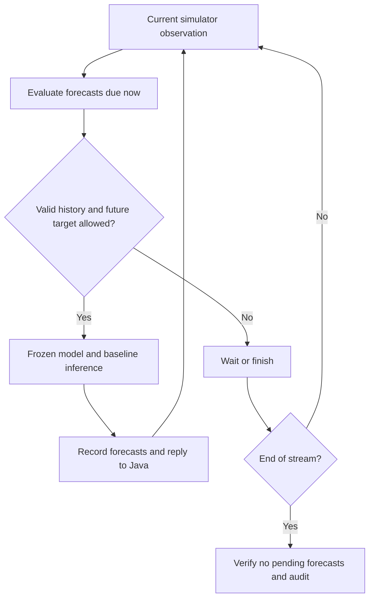

# Mobility workflow — pilot v1

Status as of 2026-11-08: the pilot workflow has completed data generation,
offline learning, held-out testing, simulator-connected frozen inference, and
evaluation when the target observation arrives. Repository closeout is pending.
This document is the consolidated workflow description. Earlier experiment notes are
archived separately outside the repository.

## Scope and progress

| Stage | Status | Evidence |
| --- | --- | --- |
| Simulator sampling and scenario configuration | Complete | Latitude, longitude, derived motion, identity and connection state exported; configurable waypoint routes |
| Dataset plan and batch generation | Complete | 12 routes × 3 speeds; 36 successful cases; 4,356 observations |
| Supervised windows | Complete | 4,032 windows: 2,688 train / 672 validation / 672 test |
| Offline LSTM training | Complete | Train-only preprocessing; best epoch 20; saved model reload passed |
| Independent test evaluation | Complete | Frozen model and preprocessing; 672 windows from six cases / two routes |
| Simulator-connected shadow inference | Complete | 121 observations; 112 prediction origins; three methods |
| Target-time evaluation and audit | Complete | 336 evaluation rows; zero pending forecasts; ordering, error and accounting checks passed |
| Consolidated documentation | Supplied | This English workflow document |
| Final repository checks, commit and push | Pending | Must be confirmed on the Windows working tree |

No additional research feature is required to close this week's workflow scope.
Active predictive handovers, additional models, larger deployments, UI changes
and language switching are outside this scope.

## Workflow and event order

Offline preparation generates simulator trajectories, constructs historical
windows, fits preprocessing and the LSTM on training data, selects the checkpoint
on validation data, and evaluates the frozen checkpoint on the held-out test set.



The Java simulator sends each observation to a persistent Python worker. It waits
for the reply before advancing simulation time. Thus SAME_SIMULATION_TICK means
the reply has the same simulation timestamp; it does not mean zero wall-clock
inference time or a simulation of network latency.

At a new observation, the worker first evaluates older forecasts whose target
time equals the current time. It then predicts the next target if allowed. The
last observation settles the final forecasts and does not issue another forecast.
Forecasts are recorded when issued and are not revised using future observations.
The worker does not read future trajectory files to construct model inputs.

## Data origin and schema

The trajectories are synthetic observations generated by the simulator using
configured waypoints and NomadicMobilityStrategy. They are not learned model
outputs and are not real-world GPS measurements. The current experiment uses one
device and two fog nodes; this is a pilot configuration, not a general simulator
capacity claim. Routes repeat; the initial rectangle is only one route choice.

`mobility_samples.csv` has these columns:

| Columns | Meaning |
| --- | --- |
| `run_id`, `device_id`, `time_ms` | Run/device identity and simulation timestamp in milliseconds |
| `latitude_deg`, `longitude_deg` | Observed geographic position in degrees |
| `delta_time_s`, `displacement_m` | Elapsed time and endpoint geodesic displacement since the preceding sample |
| `observed_speed_m_s` | Endpoint displacement divided by elapsed time; not instantaneous speed or total travelled path length / time |
| `heading_deg` | Initial bearing from the previous position to the current position |
| `motion_valid`, `heading_valid` | Validity indicators; the first sample has no preceding motion interval |
| `current_node` | Observed connection identity, including disconnection |

Bearing uses degrees in [0, 360). Heading is invalid for negligible displacement
below 0.000001 m. Distance calculations use Earth radius 6,378,137 m. A turn within
a sampling interval can make observed endpoint speed lower than configured speed.

The nominal sampling interval is 60 seconds. Each case supplies 121 observations.
The earlier UI's 122 frames included a final settlement frame; they were not 122
independent simulations or training epochs.

## Dataset and learning protocol

The fixed seed is 42 and speeds are 2.0, 4.1 and 6.0 m/s.

| Split | Routes | Cases | Windows |
| --- | --- | ---: | ---: |
| Training | rect_01–04 and tri_01–04 | 24 | 2,688 |
| Validation | zig_01–02 | 6 | 672 |
| Test | poly_01–02 | 6 | 672 |

All speeds of a route remain in its assigned split. This is a route-family holdout,
not an IID random row split. Overlapping windows are correlated; 672 test windows
do not represent 672 independent trajectories. The test set has already been used
for final evaluation and must not become a tuning set.

Each input is eight history points × six features: local east and north offsets
relative to the latest position, observed speed, sine and cosine of heading, and
heading-valid mask. Node identity is not a model input. The fixed local projection
uses latitude 47.73°, longitude 18.27° and Earth radius 6,378,137 m.

The target is east/north displacement 60 seconds after the current position.
Predicted displacement is converted back to latitude/longitude. The first usable
input requires nine raw observations because the first observation has no motion
interval. There are 112 valid origins per run: 4,032 windows in total after skipping
36 windows containing invalid initial motion. Disconnected and stationary valid
observations are retained. Windows cannot cross runs, devices or sampling gaps.

The model is LSTM(32) → Dense(16, ReLU) → Dense(2, linear), with 5,554 parameters.
Input scaling is fitted on training data only; target scaling uses a shared
training RMS scale. Heading sine/cosine and the validity mask are not standardized.
The saved preprocessing is frozen for validation, test and simulator inference.
Training uses Adam, MSE, a maximum of 60 epochs and patience 8. The observed run
stopped after epoch 28 and selected epoch 20 by validation scaled MSE.
This is a new mobility model, not reused load-prediction weights.

HoldPosition and ConstantVelocity require no training. The first keeps the current
position; the second extrapolates the last displacement. They use the same eligible
origins for the new positional-error comparison.

## Recorded results

Position errors below are great-circle distances in metres. Lower is better.

| Independent test — 672 origins | Mean | RMSE | P90 |
| --- | ---: | ---: | ---: |
| HoldPosition | 235.421 | 253.875 | 360.001 |
| ConstantVelocity | 61.507 | 118.703 | 226.492 |
| LSTM | 80.813 | 101.419 | 162.836 |

LSTM improves aggregate RMSE and P90 over ConstantVelocity here, while its mean
error is worse. It is not uniformly better across routes or metrics. This small,
synthetic pilot does not establish broad real-world accuracy.

| Development shadow session — 112 origins | Mean | RMSE | P90 |
| --- | ---: | ---: | ---: |
| HoldPosition | 235.025 | 236.979 | 246.004 |
| ConstantVelocity | 60.926 | 131.435 | 273.410 |
| LSTM | 70.573 | 97.825 | 157.410 |

The shadow session uses the development triangle at 4.1 m/s. It validates
integration, not a second independent test. It produced 336 evaluated predictions,
345 ordered journal events and zero pending forecasts. Byte accounting passed.
Model and preprocessing artifact hashes remained unchanged.

The runtime's same-platform feature comparison passed EXACT. A separate
Windows/Linux recomputation differed by at most 1.11e-16 in heading sine/cosine;
cross-platform bitwise equality is not promised.

## Entry points and artifacts

Run commands from the repository root in the existing `dissect-fog` environment.
The Java runners need a working JDK, existing simulator compiled classes, the
dependency JAR under `simulator/target`, and the project's XML resources. These
scripts do not replace the project's initial build/setup process.
The observed learning environment was Python 3.12.14, NumPy 2.5.3,
TensorFlow 2.21.0 and Keras 3.15.1, using CPU. These are recorded versions, not a
claim of compatibility with every other combination.

```powershell
# Plan validation; no simulation or training.
python predictor-ui/scripts/mobility/check_dataset_plan.py

# Dataset generation (already completed for pilot v1).
python predictor-ui/scripts/mobility/run_mobility_batch.py --all

# Replace placeholders with the directories printed by the preceding stage.
python predictor-ui/scripts/mobility/build_mobility_windows.py --batch '<batch-directory>'
python predictor-ui/scripts/mobility/train_mobility_lstm.py --windows '<windows-directory>'
python predictor-ui/scripts/mobility/evaluate_mobility_test.py --training '<training-directory>' --windows '<windows-directory>'

# Current end-to-end simulator-connected shadow entry: no retraining.
python predictor-ui/scripts/mobility/run_mobility_shadow.py --training '<training-directory>'
```

These commands describe the lifecycle; do not rerun completed training/testing just
to install documentation. The current shadow runner selects `triangle.properties`
and starts Java with `--no-ui`. Clicking ordinary Java Run does not by itself select
this frozen LSTM pipeline. The earlier UI integration displays simulator results
and the original baselines; new LSTM UI integration is not part of this closeout.

| Stage | Primary manifest / outputs |
| --- | --- |
| Batch | `mobility-batches/<id>/batch.json`, case logs and simulator CSVs |
| Windows | `mobility-windows/<id>/windows.json`, split JSONL files |
| Training | `mobility-training/<id>/training.json`, `best.keras`, `preprocessing.json`, training history and validation results |
| Test | `mobility-evaluation/<id>/evaluation.json`, predictions and aggregate/per-case/per-speed metrics |
| Shadow | `mobility-shadow/<id>/shadow-session.json`, frozen artifact/script copies, simulation log and `output/mobility-*` |

All these result roots are under `simulator/sim_res`. Shadow outputs include
`shadow_predictions.csv`, `shadow_receipts.csv`, `shadow_evaluations.csv`,
`shadow_events.jsonl` and `shadow_metrics.json`. The legacy coverage evaluation
CSVs remain separate from the new positional-error evaluation. A successful
`MOBILITY_SHADOW_STEP2_OK` marker accompanies a COMPLETE manifest and the audits;
partial or failed sessions must not be reported as complete.

The accepted Windows shadow session is `20261108T030105Z-ac3b8bbcc171`;
training is `20261108T012017Z-4ef98cf1652c`; independent evaluation is
`20261108T014558Z-944a6ad354b1`. Keep these experiment artifacts separately from
source control. A source checkout alone does not contain the trained model.

## Regression and repository closeout

```powershell
python -m unittest discover -s predictor-ui/scripts/mobility -p 'test_mobility_*.py' -v
mvn -f simulator/pom.xml '-Dtest=MobilitySampleRecorderTest,MobilityScenarioConfigTest,MobilityConnectionRegressionTest' test
git --no-pager diff --check
git status --short --untracked-files=all
```

Expected targeted suites: 40 Python tests and 17 Java tests. Individual stage
checks and the actual shadow session have passed; the final combined working-tree
checks above still need confirmation. These are targeted regression checks, not a
claim that every unrelated repository test has passed.

Review and commit only mobility source, tests, scenario configuration and docs.
Exclude `sim_res`, compiled classes, dependency JARs, model files, Python caches,
environment directories and generated installer ZIPs. Inspect the staged diff
before committing, then push the existing branch without force.

The completion boundary is a reproducible prediction-and-evaluation workflow.
Predictions do not control connections or trigger handovers; the simulator keeps
its reactive connection policy. No accuracy threshold or automatic model promotion
has been established in this pilot.
